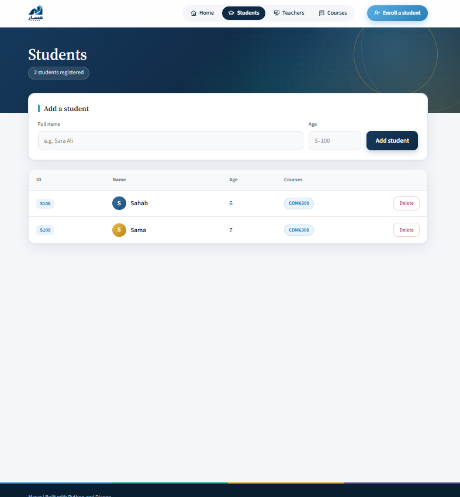
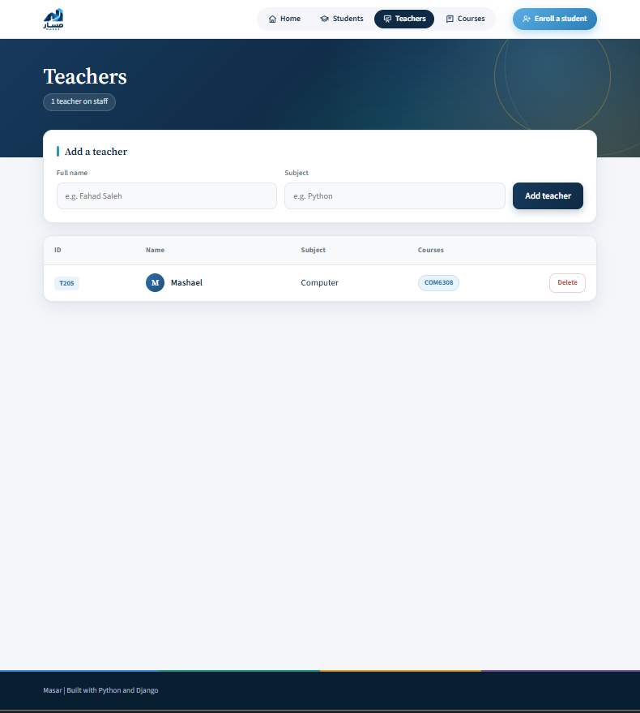
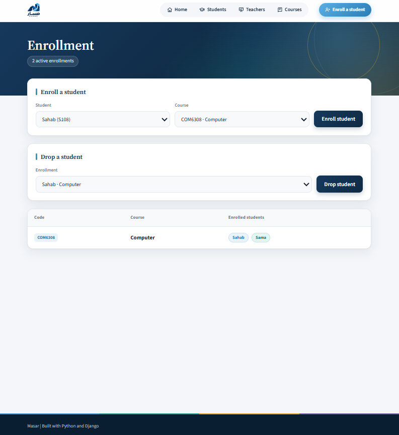
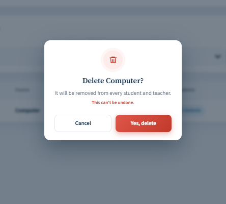
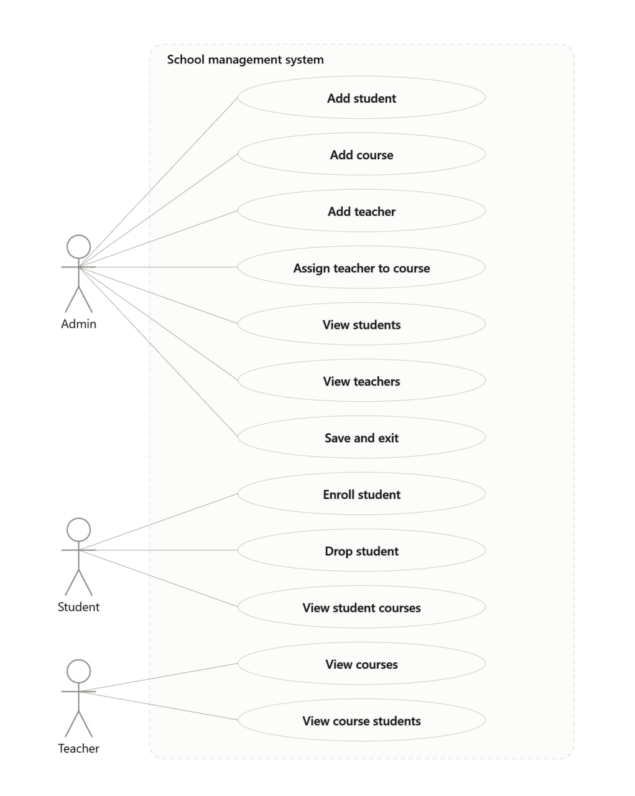

<p align="center">
  
</p>

<h1 align="center">Masar · مَسار</h1>

<p align="center">
  <b>The best way to follow every student's journey.</b><br>
  A school management web app built with Python OOP and Django.
</p>

<p align="center">
  
  
  
</p>

<p align="center">
  <a href="https://masarr.pythonanywhere.com"><b>🌐 Live demo: masarr.pythonanywhere.com</b></a>
</p>

> **This is a showcase repository.** It contains the design, the front-end code and the project documentation.
> The full source code is private. It is available on request.

---


##  About

Masar started as a console app for managing a school's students, teachers and courses, built with **Object-Oriented Programming** and saved to **JSON files**.

I then built a **Django web interface on top of the same classes**. The web app doesn't use Django models or a database. Every page calls the same `School` object the console app uses, and every change is saved back to the same JSON files.

---

##  Features

- **Students, teachers and courses:** add, view and delete, with IDs and course codes generated automatically.
- **Enrollment:** enroll a student in a course or drop them, and see who is in every course.
- **Landing page:** live counts, a features overview, a three-step guide and quick links.
- **Safe deletes:** a custom confirmation window, and every linked record is cleaned up.
- **Clear feedback:** a success or error message after every action.
- **Validation:** no empty names, no duplicates, no enrolling a student twice.
- **Custom design:** my own logo, illustrations, icon set and colour palette.
- **Responsive:** works on desktop and mobile.

---

## Screenshots

| Students | Teachers |
|---|---|
|  |  |

| Enrollment | Delete confirmation |
|---|---|
|  |  |

---

##  How It Works

```
Browser ──▶ Django views ──▶ School object (OOP) ──▶ JSON files
                ▲                                       │
                └────────────── templates ◀─────────────┘
```

| Layer | Job |
|---|---|
| Models (OOP) | `Student`, `Teacher`, `Course` and `School` classes with all the business rules |
| Web service | Loads one shared `School` object from JSON when the server starts |
| Views | Handle each page and form, call `School`, then save to JSON |
| Templates and styles | The pages, the design and the delete window *(included in this repo)* |

### Design decisions

- **Reused the OOP core instead of rewriting it as Django models**, to show that well-designed classes can power more than one interface.
- **POST, then redirect** after every form, so refreshing the page never repeats an action.
- **Deletes only accept POST** with a CSRF token, so a link can never delete data by accident.
- **One shared delete window** in the base template, reused by every page through a CSS class and `data-` attributes.
- **An SVG icon sprite** drawn once and reused with `<use>`, so icons stay sharp and inherit the text colour.

---

##  Diagrams

Planned before coding, using UML.

**Class diagram**


**Use case diagram**



**Activity diagram**


---

##  What's in This Repo

```
masar-showcase/
├── templates/       # Django templates: base, home, students, teachers, courses, enrollment
├── static/          # style.css, landing.css and images (logo, hero, illustrations)
├── screenshots/     # Screenshots used in this README
└── diagrams/        # UML class, use case and activity diagrams
```

---

##  Built With

Python · Django · HTML · CSS · JavaScript · JSON · Git

**Deployed on** PythonAnywhere, with `DEBUG` off, the secret key kept out of the code, static files served by the host, and a custom 404 page.

---

## Author

**Mashael** · Python & Django Bootcamp
[GitHub](https://github.com/Mashael16) · [LinkedIn](https://www.linkedin.com/in/mashael-alharbi-0b42822ab/)